# Morfikos POS — Frontend Architecture & Data Layer Presentation

> **Presenter:** Sanskar  
> **Stack:** Next.js (App Router) · TypeScript · Untitled UI + `next-themes` · TanStack Query · Zustand · IndexedDB (Dexie.js) · SSE + Redis Pub/Sub · Fastify + Neon PostgreSQL  
> **Scope:** Complete frontend architecture covering all 8 finalized action items — ready for team walkthrough and timeline sign-off.

---

## Slide 1: High-Level System & 5-App Separate Monorepo Architecture

Morfikos POS uses a **5-App Separate Model inside one Turborepo Monorepo** — giving **zero blast radius** across roles, isolated sessions per subdomain/port, and **100% shared packages** (`packages/ui`, `packages/access`, `packages/api-client`, `packages/validation`, `packages/types`, `packages/realtime`).
*(MVP launches with **QR ordering**; **NFC tap** plugs cleanly into `apps/guest` post-MVP at ~₹20–₹50/tag.)*

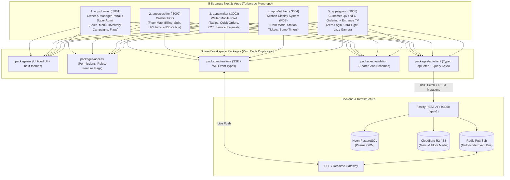

---

## Slide 2: Server Components (RSC) vs. Client Components

**Core Rule across every page & module:**
- **Old Pattern (Rejected):** `useEffect` → `fetch()` → `useState()` → loading spinner flash on every page.
- **New Pattern (Standard):** **Server Components** fetch & dehydrate initial data on the server; **Client Components (`"use client"`)** handle interactivity, optimistic mutations, and live updates.

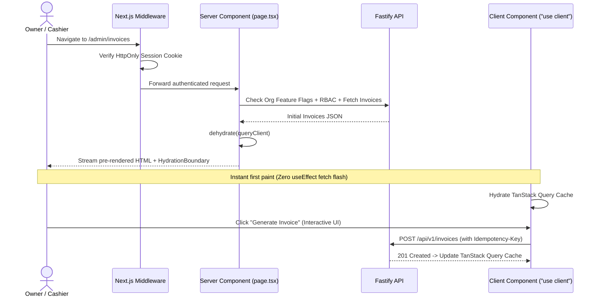

---

## Slide 3: Frontend Data Layer Architecture

No component calls raw `fetch()`. Every screen goes through one centralized **Data Layer** (`packages/api-client`) with built-in auth refresh, idempotency, caching, offline storage, and live sync.

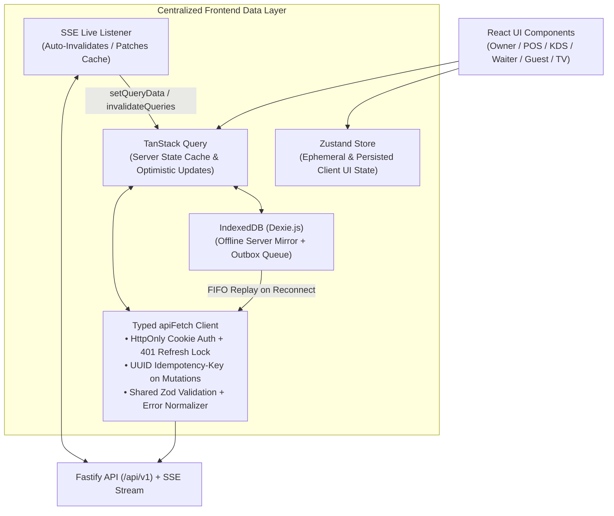

### TanStack Query Caching Policy

| Data Domain | `staleTime` | `gcTime` | Refresh / Invalidation Trigger |
| :--- | :--- | :--- | :--- |
| **Auth, RBAC & Org Feature Flags** | `5 min` | `30 min` | Login, branch switch, or `org.features.updated` SSE |
| **Menu, Categories, Floors, Tables** | `5 min` | `30 min` | Menu/floor mutation or `menu.updated` SSE |
| **Live Orders, KDS, Payments** | `0` (always live) | `10 min` | Instant SSE patch/invalidation + optimistic updates |
| **Invoices & Analytics Reports** | `2 min` | `15 min` | Filter change or `invoice.issued` SSE |

---

## Slide 4: Client State vs. Server State vs. Derived State

A clear decision flowchart every developer follows before creating any state variable:

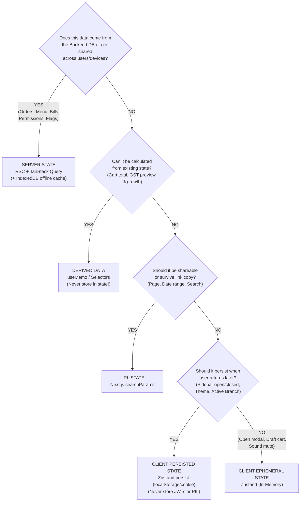

---

## Slide 5: Offline Sync Engine Flow (IndexedDB + TanStack Query)

If restaurant Wi-Fi drops — or if the browser is closed and reopened days later — **IndexedDB** preserves all local data in the **exact same structure as the server** and syncs automatically when internet returns.

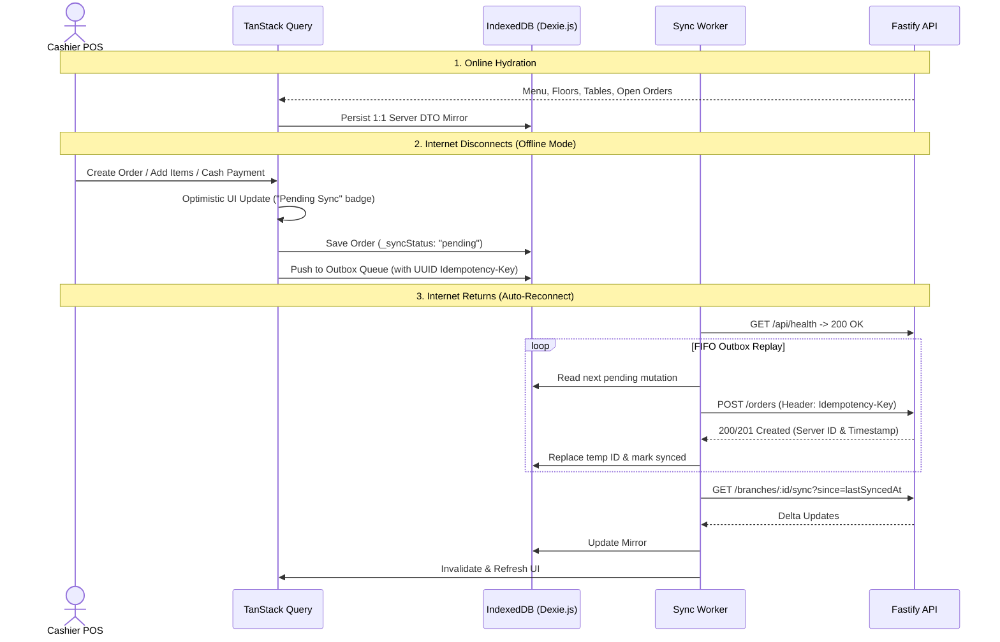

---

## Slide 6: IndexedDB Server-Mirrored Schema

Mirroring backend DTOs **1:1** inside IndexedDB means **zero data transformation** is required during offline reads or online sync.

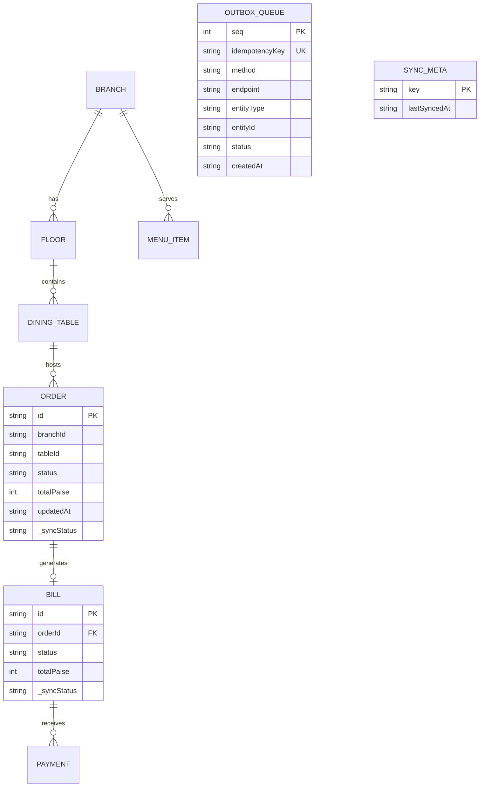

- **Works Offline:** Browse Menu & Floor Map, Create/Edit Orders, Record Tentative Cash Payments.
- **Requires Online (Disabled with badge):** UPI QR Verification, Final GST Invoice Numbering, Credit Notes, Super Admin Feature Toggles.

---

## Slide 7: Real-Time Updates Flow (SSE + Redis Pub/Sub)

**Scenario:** Cashier takes an order or payment on Table 5 → **Owner's screen** and **KDS** update instantly **without refreshing**.

**Why SSE + Pub/Sub instead of WebSockets?**
- **SSE (Server-Sent Events)** is lightweight HTTP streaming (no heavy full-duplex socket overhead when writes already use REST) with built-in browser auto-reconnect.
- **Redis Pub/Sub** is the **backend message broker** that broadcasts events across multiple API servers so SSE scales horizontally.
- **Security Fix:** SSE connects via Next.js cookie-authenticated proxy (`/api/stream/branch/[id]`) — never leaks `?accessToken=` in URLs.

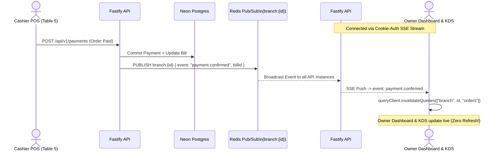

---

## Slide 8: Lazy Loading, Streaming & Prefetching Pipeline

Prevents heavy modules (Charts, Floor Canvas, PDF Invoices, Games) from slowing down initial POS or Owner load.

```mermaid
flowchart LR
    subgraph T1["Tier 1: Instant First Paint (< 1.5s)"]
        Shell["App Shell + Shared Sidebar\n(Server Rendered)"]
        KPI["Core KPI Cards / Active Tables\n(Hydrated RSC Data)"]
    end

    subgraph T2["Tier 2: Streaming (<Suspense>)"]
        Charts["Sales Charts & Heatmaps"]
        Tables["Paginated Order / Invoice Tables"]
    end

    subgraph T3["Tier 3: On-Demand (next/dynamic)"]
        Floor["Floor Plan Canvas\n(ssr: false)"]
        PDF["Invoice PDF / Print Preview"]
        Modals["Split Bill & Manager PIN Modals"]
    end

    subgraph Prefetch["Proactive Prefetching"]
        Hover["Sidebar / Card Hover\n-> queryClient.prefetchQuery()"]
        PostLogin["Post-Login Role Prefetch\n-> Cashier: Menu + Floors + Orders"]
        LinkPre["Next.js <Link prefetch>\n-> Preload Route Chunks"]
    end

    T1 --> T2 --> T3
    Prefetch -.->|"Zero Perceived Lag"| T1 & T2
```

---

## Slide 9: Unified 4-Layer Security Pipeline (Pilot: Payments & Invoices)

**Authentication + Super Admin Feature Flags + RBAC Authorization + Audit Logging** built together as one reusable pipeline — piloted end-to-end on the **Payments & Invoice Generation** module.

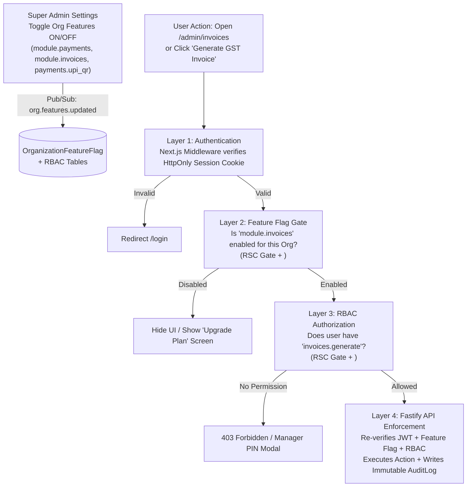

### Pilot Module Permissions & Flags Matrix

| Module | Super Admin Feature Flags | RBAC Permissions |
| :--- | :--- | :--- |
| **Payments** | `module.payments`, `payments.upi_qr`, `payments.split_bill` | `payments.view`, `payments.collect`, `payments.refund` |
| **Invoices** | `module.invoices`, `invoices.credit_notes` | `invoices.view`, `invoices.generate`, `invoices.credit_note` |

---

## Slide 10: Untitled UI Theming & Implementation Timeline

### Theming Architecture (Untitled UI + `next-themes`)

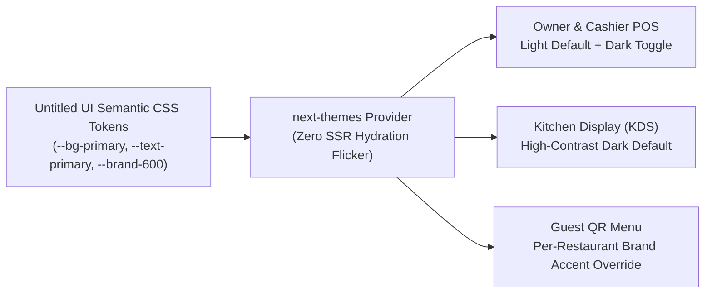

### Delivery Roadmap & Time Estimate (15 – 21 Working Days)

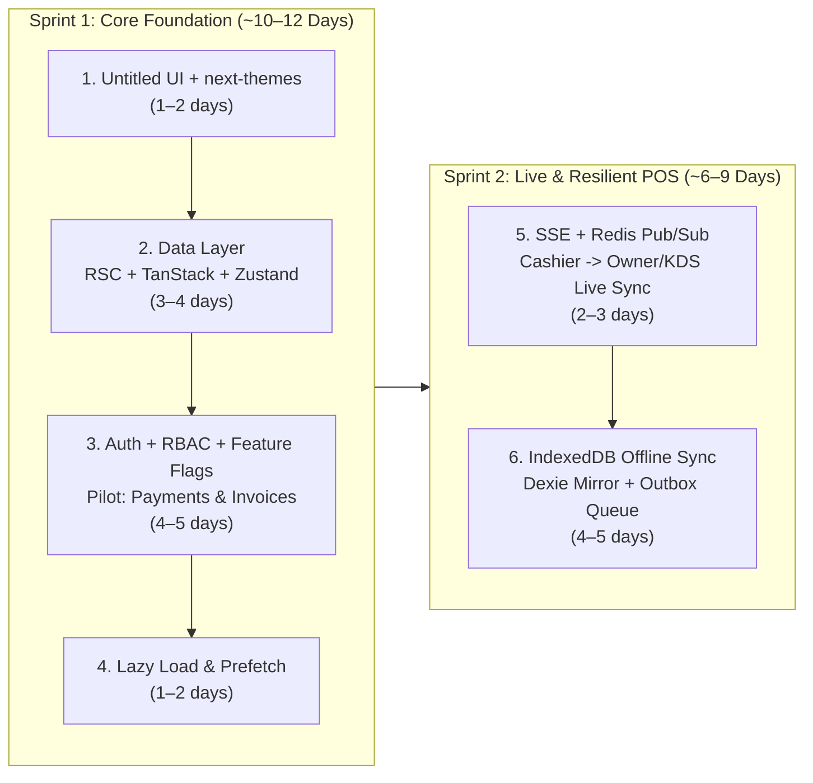

| # | Workstream | Estimate |
| :--- | :--- | :--- |
| 1 | **Theming (Untitled UI + `next-themes`)** | 1 – 2 days |
| 2 | **Core Data Layer (RSC + TanStack Query + Zustand + Client/Server Split)** | 3 – 4 days |
| 3 | **Unified Auth + RBAC + Super Admin Feature Flags (Payments/Invoices Pilot)** | 4 – 5 days |
| 4 | **Lazy Loading & Prefetching (`next/dynamic`, `<Suspense>`, `prefetchQuery`)** | 1 – 2 days |
| 5 | **Real-Time Sync (SSE + Redis Pub/Sub)** | 2 – 3 days |
| 6 | **Offline Sync Engine (IndexedDB / Dexie + Outbox + Conflict UI)** | 4 – 5 days |
| | **Total Foundation Timeline** | **15 – 21 working days (~3 – 4 weeks)** |

---

## Open Points to Confirm in Today's Meeting
1. Confirm the second theming helper package alongside **Untitled UI** (proposed: **`next-themes`** for SSR-safe dark/light switching).
2. Confirm whether the pilot module for Auth + RBAC + Feature Flags should be **Payments**, **Invoice Generation**, or **both together**.
3. Sign off on the **Sprint 1 (~2 weeks) + Sprint 2 (~1.5 weeks)** timeline so implementation can start immediately.
